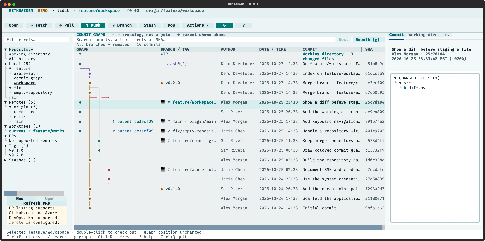

# Rhizome

A GitKraken-inspired Git workspace for your terminal. Browse branches and commits,
review diffs, stage files, and commit with a mouse or keyboard.
**Runs standalone; tmux is optional.** Uses your existing Git authentication.



## Install & run

macOS or Linux (including WSL2). Requires **Git 2.36+** and
[uv](https://docs.astral.sh/uv/); uv can install the required Python 3.13.

```sh
uv tool install --python 3.13 git+https://github.com/Doctacon/rhizome.git
rhizome /path/to/repository
```

Run `rhizome` inside a repository, or try `rhizome --demo` for a disposable
local demo. A true-color terminal at **120×40 or larger** is recommended.

## Use

- Select a commit to see its details and changed files on the right.
- Click a file to show its diff in the center; **Esc** or **Back to graph** returns.
- Use **Working directory** to stage files and commit. WIP appears in the graph only
  when you have changes.
- **Ctrl+P** opens actions, **/** searches, **?** shows help, **Ctrl+Q** quits.
- Optional tmux integration: `rhizome --tmux /path/to/repository`.
  See the [tmux guide](docs/usage.md#tmux) for the persistent pane hotkey.

Remote refs and pull requests refresh automatically on opening/resuming and every
30 seconds; local changes refresh every two seconds. Pull and push remain explicit:
pull is fast-forward-only and push never force-pushes history. Selected Git actions
run immediately, so take care with discard and reset.

[Full usage & setup](docs/usage.md) · [Pull requests](docs/pull-requests.md) ·
[Development & checks](docs/usage.md#development-and-checks)

An independent terminal adaptation, not an official GitKraken product.
