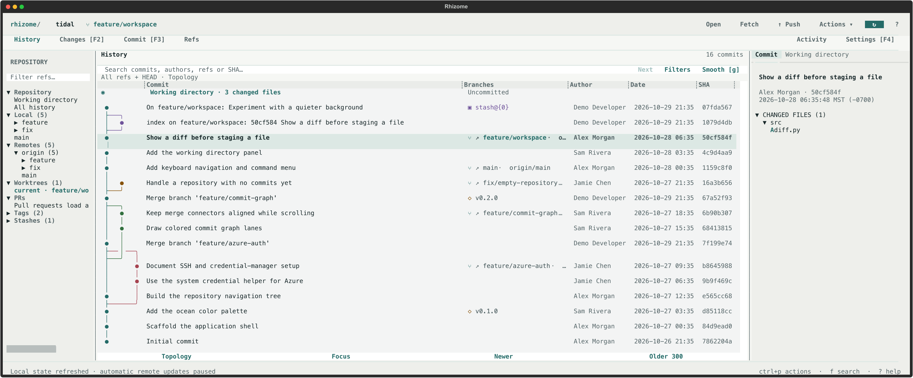

# Rhizome

A local-first Git workspace for your terminal. Browse branches and commits,
review diffs, stage exact hunks or lines, and commit with a mouse or keyboard.
**Runs standalone; tmux is optional.** Uses your existing Git authentication.



## Run

macOS, Linux, and WSL2. Requires **Git 2.36+**, **Python 3.13+**, and
[uv](https://docs.astral.sh/uv/).

```sh
git clone https://github.com/Doctacon/rhizome.git
cd rhizome
uv run --locked rhizome /path/to/repository
```

Try `uv run --locked rhizome --demo` for a disposable, local-only demo.
Use a terminal at **80×24 or larger**; wider terminals show more detail.
For a managed install with updates and rollback, see [installation](docs/installation.md).

## Use

- Select a commit to inspect it without changing your checkout.
- Activate a changed file to view its diff; **Esc** returns to the previous view.
- **Changes / F2** opens working changes. In a diff, **v** marks a line range;
  **s** stages it and **u** unstages it.
- **Commit / F3** opens the composer; drafts are saved locally.
- **Ctrl+P** opens actions, **/** searches, **F4** opens settings,
  **?** shows help, and **Ctrl+Q** quits.
- For optional tmux integration, see the [tmux guide](docs/usage.md#tmux).

The Pull menu saves your fetch/pull mode. Automatic fetch is optional;
push is explicit and never forced. Reset and discard remain unavailable.

[Full usage](docs/usage.md) · [Investigation](docs/investigation.md) ·
[Pull requests](docs/pull-requests.md) · [Development](docs/usage.md#development-and-checks)

An independent terminal adaptation, not an official GitKraken product.
